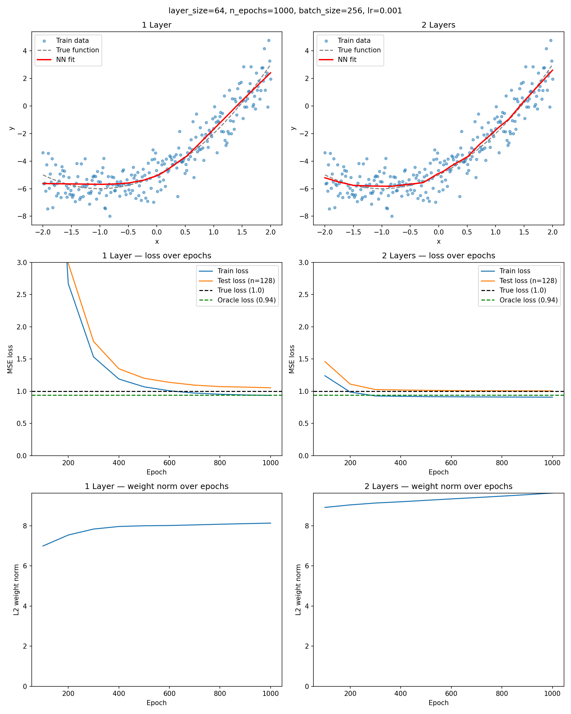
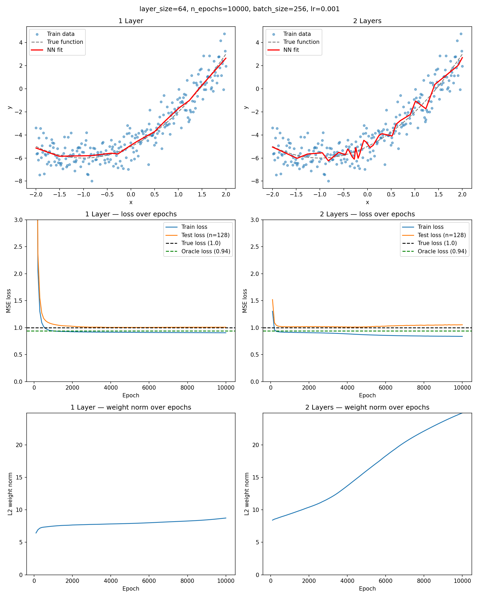
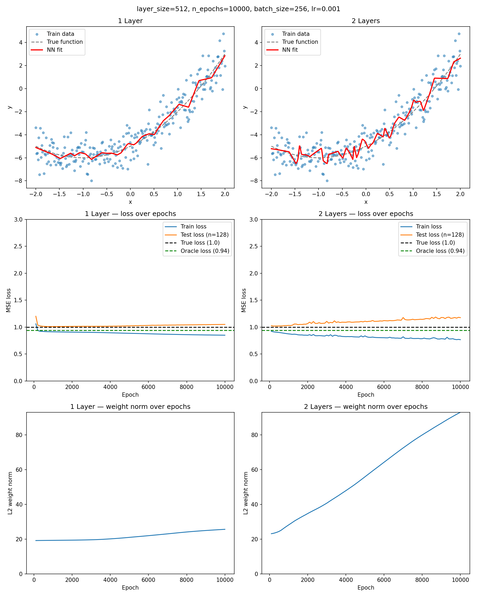
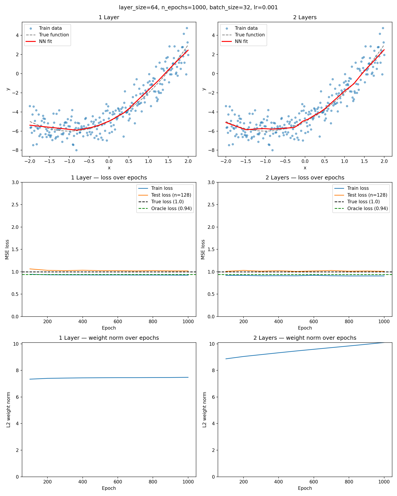
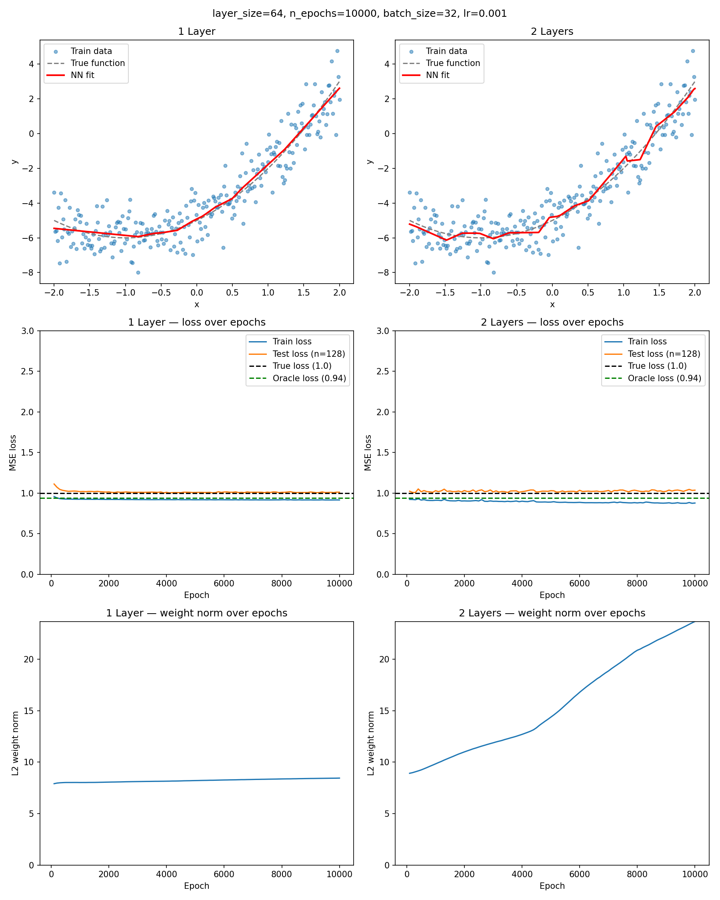
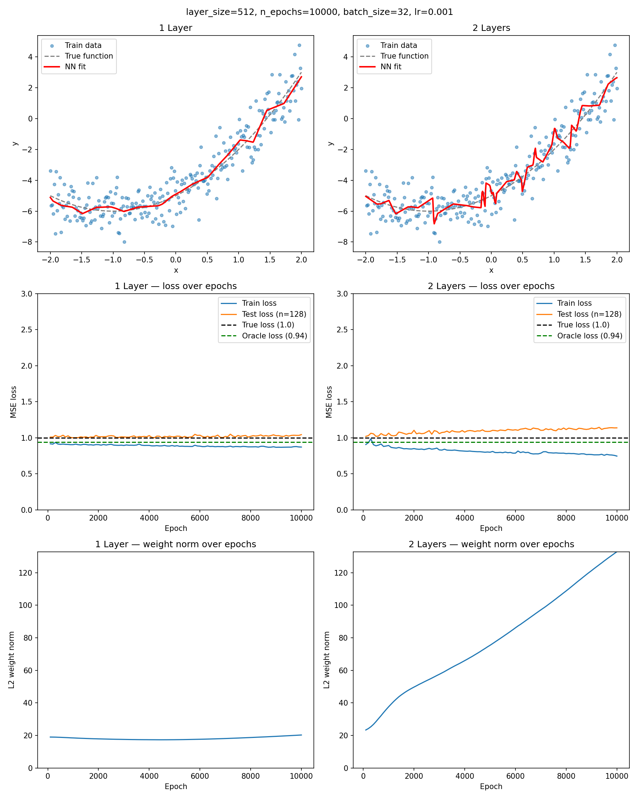
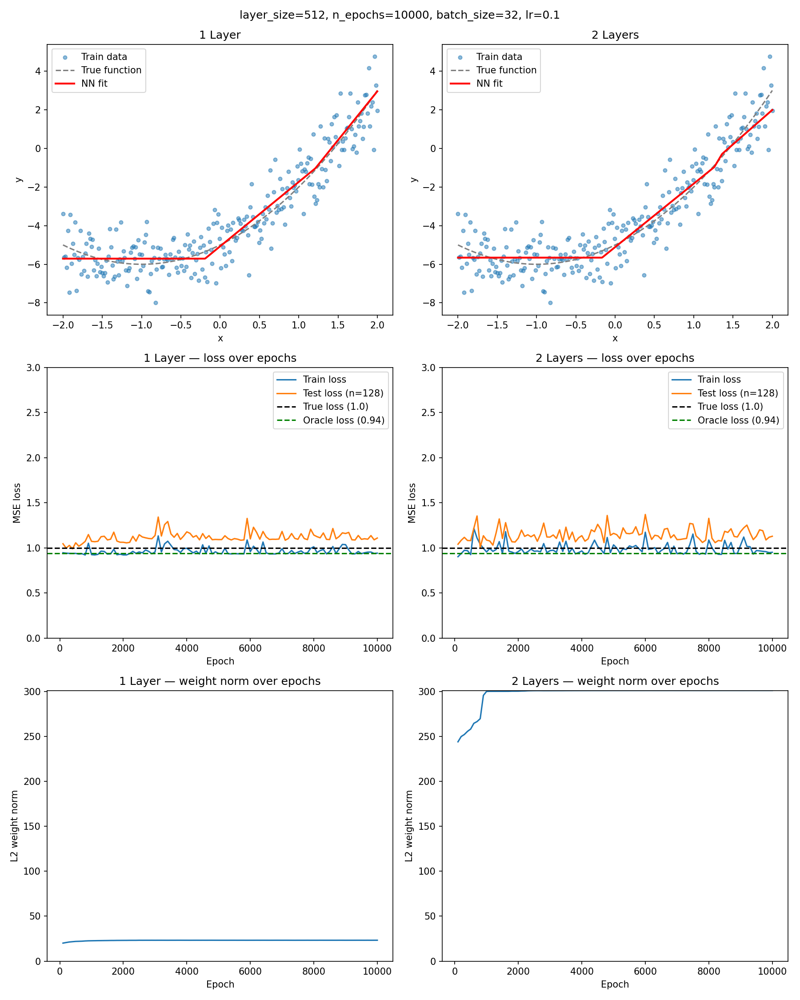
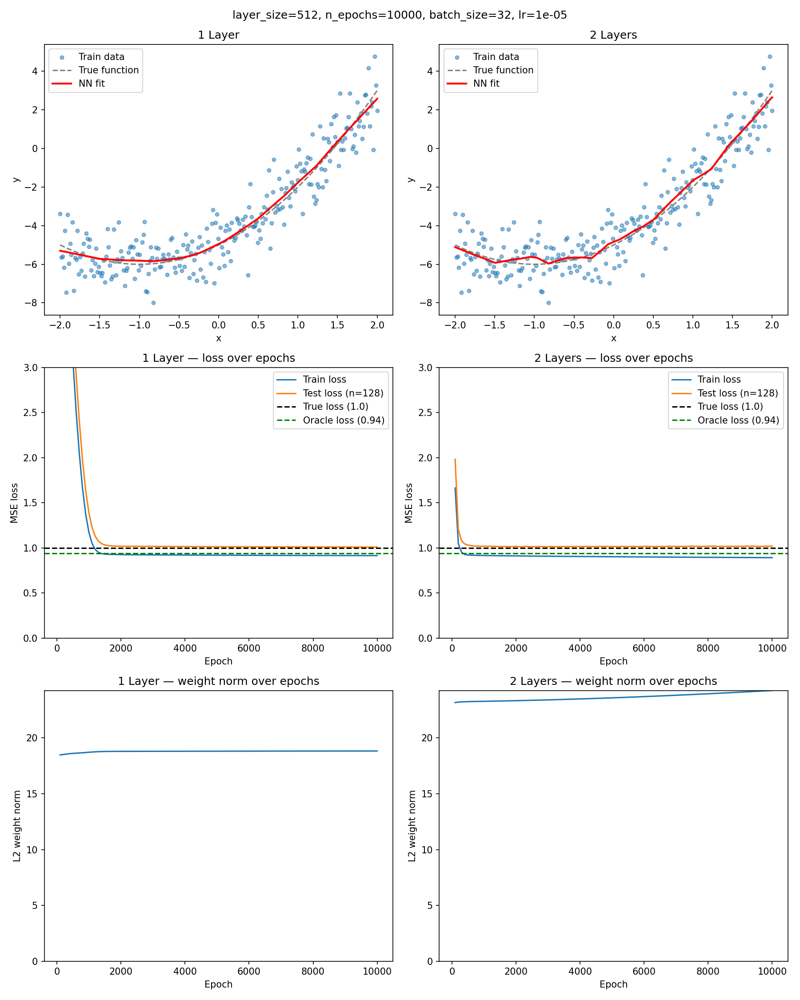

```{r, setup-r}
#| echo: false
reticulate::use_python('/usr/local/linux/miniforge-3.13/bin/python')
```

# Overview

The goal of this unit is two-fold: first to explore the concepts from the optimization unit in an important specific context and second to specifically understand more about the practical aspects of optimizing deep learning models (and how that relates back to statistical concepts as well).

Note that this unit will not cover the different architectures for deep learning models as I am woefully unqualified to do so and it is outside the scope of this course. But hopefully this will be useful for Stat 214, other courses you might take, or your work in the future.

# 1. SGD and variations for deep learning

We've seen some of the issues arising from simple gradient descent. One way to think of those is that reliance on the single current value of the gradient introduces sensitivity to the exact value. Also if one is at a saddle point, the gradient is small, leading to small updates.

## SGD (repeated from Unit 11)

Stochastic gradient descent (SGD) is a well-known method in machine learning,
commonly used for fitting deep neural networks. It allows you to
optimize an objective function with respect to what is often a very
large number of parameters even when the data size is huge.

Gradient descent is a simplification of Newton's method that does not
rely on the second derivative, but rather chooses the direction using
the gradient and then a step size, $\alpha_{t}$:
$$x_{t+1}=x_{t}-\alpha_{t}f^{\prime}(x_{t})$$

The basic idea of stochastic gradient descent is to replace the gradient
with a function whose expected value is the gradient,
$\mathbb{E}(g(x_{t}))=f^{\prime}(x_{t})$: $$x_{t+1}=x_{t}-\alpha_{t}g(x_{t})$$
Thus on average we should go in a good (downhill) direction. Given that
we know that strictly following the gradient can lead to slow
convergence, it makes some intuitive sense that we could still do ok
without using the exact gradient. One can show formally that SGD will
converge for convex functions.

SGD can be used in various contexts, but the common one we will focus on
is when $$\begin{aligned}
f(x) & = \sum_{i=1}^{n}f_{i}(x)\\
f^{\prime}(x) & = \sum_{i=1}^{n}f^{\prime}_{i}(x)\end{aligned}$$ for
large $n$. Thus calculation of the gradient is $O(n)$, and we may not
want to incur that computational cost. How could we implement SGD in
such a case? At each iteration we could randomly choose an observation
and compute the contribution to the gradient from that data point, or we
could choose a random subset of the data (this is *mini-batch SGD*), or
there are variations where we systematically cycle through the
observations or cycle through subsets. However, in some situations,
convergence is actually much faster when using randomness. And if the
data are ordered in some meaningful way we definitely do not want to
cycle through the observations in that order, as this can result in a
biased estimate of the gradient and slow convergence. So one generally
randomly shuffles the data before starting SGD. Note that using subsets
rather than individual observations is likely to be more effective as it
can allow us to use optimized matrix/vector computations.

One thing to note is that often one would scale the objective function
(and therefore the gradient) by dividing by the number of observations.
This of course doesn't change the
optimum or the directions involved, but it does mean that the magnitude
of the estimated gradient won't change with the batch size. And it means
that the expected gradient is equal to the true gradient, rather than a scaled version
of the true gradient.  


How should one choose the step size, $\alpha_{t}$ (also called the
learning rate)? One might think that as one gets close to the optimum,
if one isn't careful, one might simply bounce around near the optimum in
a random way, without actually converging to the optimum. So intuition
suggests that $\alpha_{t}$ should decrease with $t$. Some choices of
step size have included:

-   $\alpha_{t}=1/t$
-   set a schedule, such that for $T$ iterations, $\alpha_{t}=\alpha$,
    then for the next $T$, $\alpha_{t}=\alpha\gamma$, then for the next
    $T$, $\alpha_{t}=\alpha\gamma^{2}$. A heuristic is for
    $\gamma\in(0.8,0.9)$.
-   run with $\alpha_{t}=\alpha$ for $T$ iterations, then with
    $\alpha_{t}=\alpha/2$ for $2T$, then with $\alpha_{t}=\alpha/4$ for
    $4T$ and so forth.


## Momentum

An common enhancement when using gradient descent is to use "momentum". The basic idea of momentum is to modify the current gradient using past values of the gradient, using a exponentially-weighted (decaying) average of past gradient values. It can help by pushing the optimization in a consistent direction and reducing oscillations. Here's the smoothed gradient, often called the "velocity".

$$ v_{t+1} = \beta v_{t} + (1-\beta) f^{\prime}(x_{t}) $$

$\beta$ is a tuning parameter and the averaging is roughly similar to averaging over a window of  $1/(1-\beta)$ gradient values.

One can plug $v_{t+1}$ into (stochastic) gradient descent in place of the current gradient or use a variation that gives this update step, taking:

$$
v_{t+1} = \beta v_{t} + f^{\prime}(x_{t}) 
x_{t+1}=x_{t} - v_{t+1}
$$

A common value is $\beta = 0.9$.

What's the intuition? Suppose  the gradient values in a given direction have the same sign. Then the smoothed gradient in that direction will be large, so the algorithm will take large steps in that direction (including if one has just hit an area such as a saddle point where the surface is more flat), giving the algorithm inertia (momentum). Alternatively, suppose  the gradient values in a given direction oscillate (change sign). Then the smoothed gradient will be small in magnitude and the algorithm will take smaller steps in that direction, damping oscillations.

First let's see simple gradient descent on the quadratic function we used in Unit 11 to illustrate the behavior of some optimization approaches.


```{r}
#| fig-width: 10
#| fig-height: 5
#| code-fold: true
#| code-summary: "Show plotting code"
par(mai = c(.5,.4,.1,.4))
f <- function(x){
	x[1]^2/1000 + 4*x[1]*x[2]/1000 + 5*x[2]^2/1000
}
f_deriv1 <- function(x){
	c(2 * x[1]/1000 + 4 * x[2]/1000,
	4 * x[1]/1000 + 10 * x[2]/1000)
}

grad_descent <- function(init, deriv_fun, alpha, nIt) {
  xvals <- matrix(NA, nr = nIt, nc = 2)
  xvals[1, ] <- init
  for(t in 2:nIt){
    xvals[t, ] <- xvals[t-1, ] - alpha * deriv_fun(xvals[t-1, ])
  }
   return(xvals)
}

plot_path <- function(x1s, x2s, f, xvals, main = NULL, type = c('points','lines')) {
   fx <- apply(expand.grid(x1s, x2s), 1, f)
   ## plot f(x) surface on log scale
   fields::image.plot(x1s, x2s, matrix(log(fx), 100, 100), 
	xlim = range(x1s), ylim = range(x2s), xaxt='n', yaxt='n', main = main) 
   if('lines' %in% type) lines(xvals) ## overlay optimization path
   if('points' %in% type) points(xvals, pch=16, cex=0.7)
}

par(mfrow = c(1,3), mai=c(.4,.4,.3,.2))
start <- c(7, -4)
xvals <- grad_descent(start, f_deriv1, alpha = 100, nIt = 150)  ## This works pretty well.
x1s <- seq(-5, 8, len = 100); x2s = seq(-5, 2, len = 100)
plot_path(x1s, x2s, f, xvals, main = expression(alpha == 100))

xvals <- grad_descent(start, f_deriv1, alpha = 150, nIt = 200)  ## This oscillates somewhat.
plot_path(x1s, x2s, f, xvals, main = expression(alpha == 150))

xvals <- grad_descent(start, f_deriv1, alpha = 200, nIt = 200)  ## This oscillates crazily.
plot_path(x1s, x2s, f, xvals, main = expression(alpha == 200))

```

Let's see what happens with momentum. It's much more robust to the step size!

First we'll see that it essentially fixes the issues when $\alpha=200$.

```{r}
#| fig-width: 10
#| fig-height: 5
#| code-fold: true
#| code-summary: "Show plotting code"
grad_descent_with_momentum <- function(init, deriv_fun, alpha, nIt, beta = 0.9) {
  xvals <- matrix(NA, nr = nIt, nc = 2)
  xvals[1, ] <- init
  v <- 0
  for(t in 2:nIt){
    v <- beta *v  + (1-beta)* deriv_fun(xvals[t-1,])
    xvals[t, ] <- xvals[t-1, ] - alpha * v
  }
   return(xvals)
}

par(mfrow = c(1,3), mai=c(.4,.4,.3,.2))
start <- c(7, -4)
xvals <- grad_descent_with_momentum(start, f_deriv1, alpha = 100, nIt = 150)  ## This works pretty well.
x1s <- seq(-5, 8, len = 100); x2s = seq(-5, 2, len = 100)
plot_path(x1s, x2s, f, xvals, main = expression(alpha == 100))

xvals <- grad_descent_with_momentum(start, f_deriv1, alpha = 150, nIt = 200)  ## This oscillates somewhat.
plot_path(x1s, x2s, f, xvals, main = expression(alpha == 150))

xvals <- grad_descent_with_momentum(start, f_deriv1, alpha = 200, nIt = 200)  ## This oscillates crazily.
plot_path(x1s, x2s, f, xvals, main = expression(alpha == 200))
```

### Nesterov momentum

In the 1980s Nesterov came up with the idea of calculating the gradient at a position slightly ahead in the direction of the accumulated momentum, which is called Nesterov Accelerated Gradient (NAG). By looking ahead, one can reduce overshooting (in particular oscillations when one is near the optimum).

We first determine the look-ahead value:

$$ x_{\mbox{{\small look}}} = x_t - \beta v_t $$

Then we update the velocity based on the gradient at that value:

$$ v_{t+1} = \beta v_t + \alpha_t f^{\prime}(x_{\mbox{{\small look}}})$$

with the update

$$x_{t+1}=x_{t} - v_{t+1}$$

Let's try it out on our running example. We see that it suffers from oscillations
with $\alpha=150$ but with $\alpha=100$ it seems to converge more quickly than gradient
descent or gradient descent with simple momentum.


```{r}
#| fig-width: 10
#| fig-height: 5
#| code-fold: true
#| code-summary: "Show plotting code"
grad_descent_with_nag <- function(init, deriv_fun, alpha, nIt, beta = 0.9) {
  xvals <- matrix(NA, nr = nIt, nc = 2)
  xvals[1, ] <- init
  v <- 0
  for(t in 2:nIt){
    xlook <- xvals[t-1,] - beta * v
    v <- beta * v + alpha * deriv_fun(xlook)
    xvals[t, ] <- xvals[t-1, ] - v
  }
   return(xvals)
}

par(mfrow = c(1,3), mai=c(.4,.4,.3,.2))

alpha <- 50
xvals <- grad_descent_with_nag(start, f_deriv1, alpha = alpha, nIt = 200)  
plot_path(x1s, x2s, f, xvals, main = expression(alpha == 50))

alpha <- 100
xvals <- grad_descent_with_nag(start, f_deriv1, alpha = alpha, nIt = 200)  
plot_path(x1s, x2s, f, xvals, main = expression(alpha == 100))

alpha <- 150
xvals <- grad_descent_with_nag(start, f_deriv1, alpha = alpha, nIt = 200)  
plot_path(x1s, x2s, f, xvals, main = expression(alpha == 150))


```

## RMSprop and Adam

RMSprop tries to adapt the learning rate for different parameters at different rates, damping the gradient in directions with highly variable (potentially oscillating) gradient values. It maintains a weighted average of the (element-wise) *squares* of the past gradient values and scales the current gradient by the square root of that average. The result is to slow the learning in the directions with high variability.

Adam (Adaptive Moment Estimation) combines momentum and RMSprop and is widely-used.

It maintains a weighted average of the past gradient values (as with momentum) and (as with RMSprop) a weighted average of the squared gradients and scales by the square root of the average of the squared gradients.

$$ v_{t+1} = \beta_1 v_t + (1-\beta_1) f^{\prime}(x_{t}) $$
$$
S_{t+1} = \beta_2 S_t + (1-\beta_2) f^{\prime}(x_{t})^2
$$
$$
x_{t+1}=x_{t} - \alpha_{t} \frac{v_{t+1}}{\sqrt{S_{t+1}}+\epsilon}
$$

$\epsilon$ plays the usual role of dealing with denominators near zero and is often set to $10^{-8}$. Note the presence of another tuning parameter, $\beta_2 \approx 0.999$.

One also often sees that one "bias corrects" $v_{t+1}$ and $S_{t+1}$. Since they are initialized at zero, they are biased towards zero early in the iterations, which can be improved by using $v_{t+1} / (1-\beta_1^{t+1})$ and $S_{t+1} / (1-\beta_2^{t+1})$.

Here's Adam, with bias correction.

```{r}
#| fig-width: 10
#| fig-height: 5
#| code-fold: true
#| code-summary: "Show plotting code"
grad_descent_with_adam <- function(init, deriv_fun, alpha, nIt, beta1 = 0.9, beta2 = 0.999, eps = 1e-8, bias_correct = FALSE) {
  xvals <- matrix(NA, nr = nIt, nc = 2)
  xvals[1, ] <- init
  v <- 0
  s <- 0
  for(t in 2:nIt){
    grad <- deriv_fun(xvals[t-1,])
    v <- beta1 *v + (1-beta1) * grad
    s <- beta2 *s + (1-beta2) * grad^2
    v_use <- v; s_use <- s
    if(bias_correct) {
      v_use <- v_use / (1-beta1^t)
      s_use <- s_use / (1-beta2^t)
      }
    xvals[t, ] <- xvals[t-1, ] - alpha * v_use / (sqrt(s_use) + eps)
  }
  return(xvals)
}

par(mfrow = c(1,3), mai=c(.4,.4,.3,.2))

bias_correct = TRUE
alpha <- 0.1
xvals <- grad_descent_with_adam(start, f_deriv1, alpha = alpha, nIt = 200, bias_correct = bias_correct)  
plot_path(x1s, x2s, f, xvals, main = expression(alpha == 0.1))

alpha <- 0.3
xvals <- grad_descent_with_adam(start, f_deriv1, alpha = alpha, nIt = 200, bias_correct = bias_correct)  
plot_path(x1s, x2s, f, xvals, main = expression(alpha == 0.3))

alpha <- 1
xvals <- grad_descent_with_adam(start, f_deriv1, alpha = alpha, nIt = 200, bias_correct = bias_correct)
plot_path(x1s, x2s, f, xvals, main = expression(alpha == 1))
```

Finally, we'll see that bias correction was quite helpful. Without it we oscillate/overshoot a lot more.

```{r}
#| fig-width: 10
#| fig-height: 5
#| code-fold: true
#| code-summary: "Show plotting code"
par(mfrow = c(1,3), mai=c(.4,.4,.3,.2))

bias_correct = FALSE

alpha <- 0.1
xvals <- grad_descent_with_adam(start, f_deriv1, alpha = alpha, nIt = 200, bias_correct = bias_correct)  
plot_path(x1s, x2s, f, xvals, main = expression(alpha == 0.1))

alpha <- 0.3
xvals <- grad_descent_with_adam(start, f_deriv1, alpha = alpha, nIt = 200, bias_correct = bias_correct)  
plot_path(x1s, x2s, f, xvals, main = expression(alpha == 0.3))

alpha <- 1
xvals <- grad_descent_with_adam(start, f_deriv1, alpha = alpha, nIt = 200, bias_correct = bias_correct)
plot_path(x1s, x2s, f, xvals, main = expression(alpha == 1))
```


# 2. The Bias-Variance Tradeoff, Overfitting, Regularization, and Double Descent

## The classical (statistical) perspective

A core principle in statistics is the bias-variance tradeoff.

Models with few parameters and/or limited flexibility/expressivity will be biased in fitting the data because they are not flexible enough to capture all the structure in the data but have low variance because there is a lot of data relative to the number of parameters.

Models with many parameters will have little bias, but high variance, with the variance caused by the model fitting to noise in addition to structure/signal in the data. Remember that in a classical statistical context, signal is what occurs in all the different samples that one might observe, while noise differs from sample to sample.

The result is that the test error as a function of the model complexity will show a U-shaped curve for the test error, which decreases initially with more parameters (from lower bias) and then increases (from higher variance).

Some strategies for addressing the bias-variance tradeoff to try to fit signal but not noise include

 - model selection (of which variable selection is one form) based on optimizing a loss that tries to capture test (not train) error,
 - penalization/regularization to avoid overly variable fitting, and
 - early optimization stopping (which can be seen as a kind of implicit regularization), such as by monitoring hold-out error.

Therefore, the classical statistical paradigm for fitting parametric models is that, holding the sample size fixed, as the number of parameters increases, the model will overfit. What does this mean?

As the number of parameters gets "large", there will be enough parameters to start fitting to noise in the data as well as to real features in the data. One will see very good predictive performance on the training data, and with enough parameters (e.g., as many parameters as observations) one can exactly fit the training data, even though some portion of the variation in the training data is noise. Then when the fitted model is applied to test data, which has different values of the noise than the training data, predictive performance will be much lower.  In other words the generalization error (difference between train and test error) is large.

We can see this for a simple nonparametric regression setting in one dimension. Standard generalized additive model tools (most famously, `mgcv::gam` in R) fit a penalized spline with the amount of regularization determined based on trying to estimate test loss in some fashion (GCV, AIC, REML, etc.).

```{r}
set.seed(1)

fun <- function(x) x^2 + 2*x -5
n = 200
x = seq(-2, 2, length = n)
f <- fun(x)
y = rnorm(n, f, 1)

# Unpenalized, ~150 knots
library(splines)
Xmat150 <- bs(x, df = 150)
mod150 <- lm(y ~ Xmat150)
pred150 <- predict(mod150)

# Unpenalized, 1 knot
Xmat4 <- bs(x, df = 4)
mod4 <- lm(y ~ Xmat4)
pred4 <- predict(mod4)

# With automatic penalization
library(mgcv)
gam_mod <- gam(y ~ s(x))
gam_pred <- predict(gam_mod)

plot(x, y)
lines(x, f)
lines(x, pred4, col = 'blue', lwd = 3)
lines(x, gam_pred, col = 'green', lwd = 3)
lines(x, pred150, col = 'red')
legend('topleft', legend = c('truth', 'unpenalized (df=150)', 'unpenalized (df=4)', 'penalized'),
                  col = c('black','red','blue','green'), lwd = c(1,1,3,3))
```

Finally note that in the classical setting, we can't even fit  a regression spline in the overparameterized regime because $X^{\top} X$ is singular and can't be inverted.


## Overfitting in deep learning

[This well-known ArXiv paper](https://arxiv.org/pdf/1611.03530) shows that deep neural nets (in particular ConvNets for image processing) can perfectly fit noise in observations, resulting in zero train error and large test error. This indicates that nothing in the model architecture is providing regularization. And while one can introduce regularization explicitly (such as through weight decay and dropout), in many uses of deep learning regularization is not used. The ArXiv paper authors show that explicit regularization helps a bit, but that unregularized solutions do nearly as well. So how can deep neural networks avoid overfitting? The authors say that it is SGD itself that results in a regularized solution that generalizes well, without requiring explicit regularization.

[This well-known PNAS paper](https://www.pnas.org/doi/pdf/10.1073/pnas.1903070116) introduced the term "double descent" to describe how increasing model size past the interpolation point (n=p) improves test error (hence the second descent after the first descent as one initially adds parameters) (see their Fig. 1). They discuss the idea that with more parameters (a larger model/function class) one can find a model that fits the training data perfectly while also being smooth (having small norm on the model parameters/coefficients) (and thereby generalizing well). They illustrate this by explicitly including the norm in their loss function. And as above, the reason that neural net performance is good (even without regularization) is that standard optimization procedures used for these problems tend to find small norm solutions.

In some cases, practitioners have also seen double descent occur in epoch-space - that as the test error decreases then increases as the number of epochs becomes larger and then decreases again, presumably as the optimization finds more smooth solutions (perhaps because it [favors flatter areas of the parameter space](https://arxiv.org/abs/1609.04836)). Note that one can potentially achieve good performance based on early stopping by monitoring test error on a held-out set (or something similar), since the model weights/parameters generally start at small values and take some time to become larger, which is generally when the overfitting happens.


Let's see what happens if we use neural networks to fit the nonparametric regression.

Here's the Python script I set up to do the fitting and plotting for various configurations of the data size, model structure, and optimization tuning parameters.

```{python}
#| eval: false
#| code-fold: true
#| code-summary: "Show fitting code"

import numpy as np
import torch
import torch.nn as nn
import torch.optim as optim
from torch.utils.data import DataLoader, TensorDataset
import matplotlib.pyplot as plt
import argparse
import sys

# --- Command-line arguments ---
parser = argparse.ArgumentParser(description="Fit neural networks with minibatch SGD.")
parser.add_argument("--n", "-n", type=int, default=256, help="Training sample size")
parser.add_argument("--layer_size", "-l", type=int, default=64, help="Units per hidden layer")
parser.add_argument("--n_epochs", "-e", type=int, default=2000, help="Number of training epochs")
parser.add_argument("--batch_size", "-b", type=int, default=32, help="Minibatch size (use n for full-batch)")
parser.add_argument("--lr", "-r", type=float, default=1e-3, help="Adam learning rate")
parser.add_argument("--seed", "-s", type=int, default=1, help="Random seed/replicate")
args = parser.parse_args()

n = args.n
layer_size = args.layer_size
n_epochs = args.n_epochs
batch_size = args.batch_size
lr = args.lr
seed = args.seed

# --- Data generation (mirrors R gam example) ---
def fun(x):
    return x**2 + 2*x - 5


# --- Model definitions ---
class OneDenseLayer(nn.Module):
    def __init__(self, layer_size=256):
        super().__init__()
        self.net = nn.Sequential(
            nn.Linear(1, layer_size),
            nn.ReLU(),
            nn.Linear(layer_size, 1),
        )

    def forward(self, x):
        return self.net(x)


class TwoDenseLayers(nn.Module):
    def __init__(self, layer_size=256):
        super().__init__()
        self.net = nn.Sequential(
            nn.Linear(1, layer_size),
            nn.ReLU(),
            nn.Linear(layer_size, layer_size),
            nn.ReLU(),
            nn.Linear(layer_size, 1),
        )

    def forward(self, x):
        return self.net(x)


# --- Training helper (minibatch SGD) ---
def train(model, X_train, y_train, X_test, y_test, n_epochs=2000, lr=1e-3, batch_size=32):
    optimizer = optim.Adam(model.parameters(), lr=lr)
    loss_fn = nn.MSELoss()
    dataset = TensorDataset(X_train, y_train)
    loader = DataLoader(dataset, batch_size=batch_size, shuffle=True)
    train_losses, test_losses, weight_norms = [], [], []
    for epoch in range(n_epochs):
        model.train()
        for X_batch, y_batch in loader:
            optimizer.zero_grad()
            loss = loss_fn(model(X_batch), y_batch)
            loss.backward()
            optimizer.step()
        if (epoch + 1) % 100 == 0:
            with torch.no_grad():
                model.eval()
                train_loss = loss_fn(model(X_train), y_train).item()
                test_loss = loss_fn(model(X_test), y_test).item()
                norm = sum(p.norm().item() ** 2 for p in model.parameters()) ** 0.5
            train_losses.append(train_loss)
            test_losses.append(test_loss)
            weight_norms.append(norm)
            if (epoch + 1) % 500 == 0:
                print(f"  epoch {epoch+1:5d}  train={train_loss:.4f}  test={test_loss:.4f}  |w|={norm:.2f}")
    return train_losses, test_losses, weight_norms

# --- Minibatch size (try 8, 32, 64, 256 = full batch) ---
# (set via --batch_size)

np.random.seed(seed)
x = np.linspace(-2, 2, n)
y = fun(x) + np.random.randn(n)

X_tensor = torch.tensor(x, dtype=torch.float32).unsqueeze(1)
y_tensor = torch.tensor(y, dtype=torch.float32).unsqueeze(1)

# --- Test data (independent draw, n_test = n // 2) ---
n_test = n // 2
x_test = np.linspace(-2, 2, n_test)
y_test = fun(x_test) + np.random.randn(n_test)

X_test_tensor = torch.tensor(x_test, dtype=torch.float32).unsqueeze(1)
y_test_tensor = torch.tensor(y_test, dtype=torch.float32).unsqueeze(1)

# --- True loss: noise variance (sigma^2 = 1) ---
true_loss = 1.0

# --- Oracle loss: MSE of true function on training data ---
_y_true_train = torch.tensor(fun(x), dtype=torch.float32).unsqueeze(1)
oracle_loss = nn.MSELoss()(_y_true_train, y_tensor).item()
print(f"Oracle loss (fun(x) vs y): {oracle_loss:.4f}")

# --- Fit grid for smooth prediction curve ---
x_grid = np.linspace(-2, 2, 500)
X_grid = torch.tensor(x_grid, dtype=torch.float32).unsqueeze(1)
y_true_grid = fun(x_grid)


def fit_and_plot(layer_size, n_epochs, batch_size, lr, seed):
    print(f"\n=== layer_size={layer_size}, n_epochs={n_epochs}, batch_size={batch_size}, lr={lr} ===")

    print("Training 1-layer network ...")
    model1 = OneDenseLayer(layer_size)
    train_losses1, test_losses1, weight_norms1 = train(
        model1, X_tensor, y_tensor, X_test_tensor, y_test_tensor,
        n_epochs=n_epochs, batch_size=batch_size, lr=lr,
    )
    model1.eval()
    with torch.no_grad():
        y_pred1 = model1(X_grid).squeeze().numpy()

    print("Training 2-layer network ...")
    model2 = TwoDenseLayers(layer_size)
    train_losses2, test_losses2, weight_norms2 = train(
        model2, X_tensor, y_tensor, X_test_tensor, y_test_tensor,
        n_epochs=n_epochs, batch_size=batch_size, lr=lr,
    )
    model2.eval()
    with torch.no_grad():
        y_pred2 = model2(X_grid).squeeze().numpy()

    record_every = 100
    epochs = np.arange(record_every, n_epochs + 1, record_every)
    titles = [f"1 Layer", f"2 Layers"]

    fig, axes = plt.subplots(3, 2, figsize=(12, 15))
    fig.suptitle(f"layer_size={layer_size}, n_epochs={n_epochs}, batch_size={batch_size}, lr={lr}",
                 y = .99)

    # Top row: scatter + fit
    for ax, y_pred, title in zip(axes[0], [y_pred1, y_pred2], titles):
        ax.scatter(x, y, s=15, alpha=0.5, label="Train data")
        ax.plot(x_grid, y_true_grid, color="gray", linestyle="--", label="True function")
        ax.plot(x_grid, y_pred, color="red", linewidth=2, label="NN fit")
        ax.set_title(title)
        ax.set_xlabel("x")
        ax.set_ylabel("y")
        ax.legend()

    # Bottom row: train/test loss over epochs
    for ax, trl, tel, title in zip(
        axes[1],
        [train_losses1, train_losses2],
        [test_losses1, test_losses2],
        titles,
    ):
        ax.plot(epochs, trl, label="Train loss")
        ax.plot(epochs, tel, label=f"Test loss (n={n_test})")
        ax.axhline(true_loss, color="black", linestyle="--", label="True loss (1.0)")
        ax.axhline(oracle_loss, color="green", linestyle="--", label=f"Oracle loss ({oracle_loss:.2f})")
        ax.set_title(f"{title} — loss over epochs")
        ax.set_xlabel("Epoch")
        ax.set_ylabel("MSE loss")
        ax.set_ylim(0, 3)
        ax.legend()

    # Third row: weight norm over epochs
    max_norm = max(max(weight_norms1), max(weight_norms2))
    for ax, wn, title in zip(
        axes[2],
        [weight_norms1, weight_norms2],
        titles,
    ):
        ax.plot(epochs, wn)
        ax.set_title(f"{title} — weight norm over epochs")
        ax.set_xlabel("Epoch")
        ax.set_ylabel("L2 weight norm")
        ax.set_ylim(0, max_norm)

    plt.tight_layout()
    fname = f"nn_regr_batch_n{n}_{layer_size}_{n_epochs}_{batch_size}_lr{lr}_seed{seed}.png"
    plt.savefig(fname, dpi=150)
    print(f"  Plot saved to {fname}")
    if sys.flags.interactive:       # Plot if in an interactive session.
        plt.show()

fit_and_plot(layer_size, n_epochs, batch_size, lr, seed)

```


With a small model (64 neurons), if one stops before a lot of iterations (epochs), there is not much overfitting.

{fig-alt="Results from fitting a neural network regression"}


Note that it's not clear we would call that "early stopping", since 1000 epochs is actually quite large for such a small problem.

If one lets the optimization continue (somewhat unrealistically), training error decreases slowly and we see some additional overfitting. Using a larger model (larger layers or two layers) illustrates the overfitting quite noticeably. Note that even with the overfitting, there is clearly still some regularization happening (given we know that the model is large enough to exactly fit the data).

Here are the results for the 64-neuron case with 10000 epochs.

{fig-alt="Results from fitting a neural network regression"}

And here for the 512 neuron case with 10000 epochs.

{fig-alt="Results from fitting a neural network regression"}


## Minibatches

Stochastic gradient descent (and related methods described above) substitute a noisy (but unbiased) estimate of the gradient in place of the full gradient, as already discussed. That noisy estimate is generally an estimate based on the gradient contributions from a (random) subset of the observations, using a small subset such as 32-512 data points.

There are different ways to choose the minibatches -- one potentially important choice is whether to cycle through all the observations in minibatches in an epoch or randomly create a minibatch. The latter would be true SGD and is easier to analyze mathematically because the minibatches are independent, but in practice researchers have found good results if one randomly shuffles the observations at the start of each epoch (e.g., PyTorch's DataLoader with `shuffle=True`) and within an epoch cycle through all the observations in minibatches.

One thing to think about in choosing a minibatch size is that the minibatch datasize fits in memory (CPU or GPU depending on which you are using) and/or in the CPU cache.

Recall from the main optimization unit that each step only moves us somewhat in the right direction and we don't want to spend a lot of time choosing the exact right amount to go in that single step. Similarly we don't want to spend a lot of time choosing exactly the right direction. We are iteratively exploring a space and making many descent steps quickly is better than making one "best" step.

Apparently the term 'batch' refers to the entire dataset, hence 'mini-batch' is a small subset of the dataset. That terminology might be confusing (since I might think of a batch as being the same as a chunk or shard or subset), but it seems to be standard.


One advantage of minibatches is purely computational efficiency. We can choose a reasonable direction to go and make progress in that direction without having to compute the gradient for all of the observations. This was the first motivation. The second motivation, which was realized later, is that it seems to also reduce generalization error, providing some sort of implicit regularization in many situations. In [this ArXiv paper](https://arxiv.org/abs/1609.04836) the authors argue that use of small batches results in finding optima in flat parts of the space that give smoother solutions that generalize better. However, [this ArXiv paper](https://arxiv.org/abs/1703.04933) provides evidence against the idea that finding solutions in flat areas is what explains the good generalization performance).

What happens if we use minibatching in the regression example?

Here we see good performance when stopping after 1000 epochs.
{fig-alt="Results from fitting a neural network regression, mini-batches"}

Here we start to see overfitting when going up to 10000 epochs.

{fig-alt="Results from fitting a neural network regression, mini-batches"}

And finally we see substantial overfitting with a larger model with many epochs.


{fig-alt="Results from fitting a neural network regression, mini-batches"}

By comparing with the previous results, we can see a few things:

- There's not a lot of evidence in this particular small example that using minibatches results in lower generalization error.
- In general (particularly with larger models and many epochs), we do still see a generalization gap that grows with the number of epochs.
- Early-ish stopping combined with minibatches seems to work well.


For many years, the standard approach was to use multiple minibatches in an epoch and train for many epochs. More recently there has been a shift in some domains to using a very small number of epochs, particularly in settings with huge data sizes. Note that with large datasets, even when using only a few epochs, one is still doing a large number of gradient steps.


## The learning rate and the process of updating weights

The learning rate is also an important part of the puzzle. It affects computational efficiency (overly small values will take a long time to reach an 'optimum') but also the performance of the trained model and interplays with the batch size since the amount of information available for any given step relates to the number of observations in the batch. This affects  how the optimization moves through the space and settles on a solution. In [this ArXiv paper](https://arxiv.org/pdf/2101.12176), the authors discuss first that with a very small learning rate, the optimization with minibatches follows the gradient flow to a local minimum, but with larger learning rates the optimization path is what one would get if optimizing a regularized objective function.

Here are some results with smaller and larger learning rates for the regression example. With a large learning rate of 0.1, the results don't seem very stable (based on the noisy evolution of the loss (and large weight values for the two-layer model), but the fits actuallyseem over-smoothed. 

{fig-alt="Results from fitting a neural network regression, mini-batches"}

For the small learning rate of 0.00001, convergence takes a large number of iterations, but the fitting seems stable over a large number of iterations and the fit is good, with little generalization error.

{fig-alt="Results from fitting a neural network regression, mini-batches"}


Suppose we are interested in whether we can improve the value of a specific weight in a neural network using sigmoid activation. Consider that at a given layer in the network,  $a^{(l)} = \sigma(\sum_k w^{(l)}_k a^{(l-1)} + b^{(l)})$.
With a bit of investigation of the backpropagation algorithm for calculating the gradient of the loss with respect to the weights, one can see that the update to a weight will be small if:

- The input neuron, $a^{(l-1)}$ has a small value (low activation)
- The output neuron has saturated (the value of $w^{(l)} a^{(l-1)} + b^{(l)}$ is very large or small, such that the derivative of the sigmoid function is near zero.

One way to see this is to consider a simplified update that ignores the summation above, giving the value for a neuron at layer $l$ as $a^{(l)} = \sigma(w^{(l)} a^{(l-1)} + b^{(l)})$, with gradient $\sigma^{'}(w^{(l)} a^{(l-1)} + b^{(l)}) a^{(l-1)}$.

This plays out differently when using ReLU activation functions since their derivative is zero for negative inputs and unbounded for positive. The unboundedness can result in less stability in the updates. And the zero derivative can mean that a neuron gets stuck in the "off" position if its inputs are always negative. In backpropagation, the weights/coefficients that feed into such a neuron don't get updated through that neuron (though they would through other "live" neurons).

One can also see a slow learning rate if you have a deep network and small magnitude weights, in which case the gradient behaves like the product of the weights (modulated by the activation function) and can be quite small. This is known as the vanishing gradient problem; with the counterpart exploding gradient problem when the weights are large, which can result in instability in fitting since individual gradient descent steps can be very large.

Careful initialization can help with vanishing/exploding gradients. In particular the magnitude (quantified by the variance) of the initial values in a layer should scale inversely with the number of weights in the layer, to give weights with values whose magnitude is around 1. For RELU, the standard is to scale things by using 2 divided by the number of weights.


## Other aspects of optimization/training

### Learning rate decay

If one chooses a constant value of the learning rate, $\alpha$, when using mini-batches, one will never converge to a (local) optimum but will oscillate around the optimum because the gradient estimate at each step will not be exactly zero. So an additional option for improving optimization is to set the learning rate to decay with the number of epochs (or the number of steps).

In recognition of this, and also that as one gets closer to the minimum one generally would want to be more careful about the steps one takes, one often uses a "schedule" by which the learning rate decreases as a function of the epoch number.

A common schedule is:

$$
\alpha = \frac{1}{1+\rho  m} \alpha_0
$$

where $\alpha_0$ is the initial learning rate, $\rho$ is a decay parameter, and $m$ is the number of epochs. One may need to tune $\rho$. Or one might use exponential decay: $\alpha = \rho^m \alpha_0$. And there are other approaches that are used in practice.


### Input normalization

It's generally a good idea to 'normalize' your inputs (i.e., shift and scale them to remove the mean and standardize the variance). This generally produces an objective function that is more spherical and less elliptical/elongated. We saw in the Optimization unit that part of the difficulty with pure gradient descent is that it doesn't account for how the gradient changes as one moves through the space and that Newton's method, by using the Hessian, accounts for this and helps avoid big oscillations. Of course in deep learning we can't use 2nd derivative information for efficiency reasons, so transforming your inputs is quite useful. Another way to think about this is that if we have an elliptical surface, we would want the learning rate to vary by dimension, whereas with a spherical one, we can use a single learning rate, which of course is what one wants, to avoid a high-dimensional hyperparameter search space.

### Local optima

In low dimensions, it's easy to think about having local optima that an optimization algorithm will get stuck in. But in high dimensions, having a local optimum requires that the Hessian in all directions be zero. This is much less likely than that some of second derivatives will be positive and some negative, in which case one is at a saddle point. So long as your optimization algorithm doesn't get stuck at exactly the saddle point (which it shouldn't because of the stochastic gradients (and as well from using techniques like momentum), then this shouldn't cause a big problem.

What tends to be more of a problem is having slow learning in plateaus where the gradients are shallow and steps are small. Momentum and related techniques can help with this.

### Hyperparameter tuning

We've seen that there are a variety of tuning parameters, including model architecture and tuning parameters. In his deep learning course, Andrew Ng suggests first considering the learning rate, $\alpha$, and then after that the momentum hyperparameter, the mini-batch size, and the number of hidden units.

An obvious strategy is to do a grid search over the hyperparameters. An alternative is to choose the points at random. This results in more unique values of each hyperparameter, which can be particularly useful if it turns out one or more of the hyperparameters don't really matter at all, which when using a grid would mean that a bunch of your grid points are redundant.

One might also try to zoom in on the best values by using a second round of optimization after determining roughly the right magnitude of values initially.

What about the scale of values to consider? Often we want to range over multiple orders of magnitude, so we want to search on the log scale. For the parameter in an exponentially-weighted average, you'd want to search over $1-\beta$ on the log scale.

### Batch normalization

Another common strategy when fitting neural networks is to normalize the values of the hidden units (usually before passing through the activation function) to have a particular layer-specific mean and variance (that might be learned during training). The intuition is similar to that for normalizing the inputs -- to have all the predictors on the same scale and hopefully have more spherical objective function contours.

One way to think about the effect of batch normalization is that it keeps the magnitudes and spread of the hidden unit values stable over the iterations, reducing what one might think of as a sort of 'covariate shift' within the model. This could happen because the hidden unit values are constantly changing as the optimization updates the parameters (the weights). 

